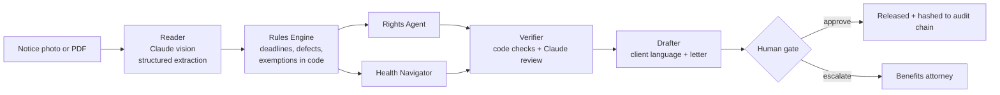

# Kalinga

**A benefits notice decoder for the navigators who keep women and families covered.**

*Kalinga* is Tagalog for care. Built for Code with Claude: Women in AI Hackathon (Women's health, Safety and rights tracks), with a planned pilot at Filipino Advocates for Justice in the Bay Area.

## The problem

Roughly 15 million Californians rely on Medi-Cal. Women are a majority of adult Medicaid enrollees, Medicaid covers about four in ten U.S. births, and women are often the family member who manages coverage for children and aging parents. Starting January 1, 2027, new federal work reporting rules and six-month renewals will send millions more notices. One missed deadline on a confusing letter can end prenatal or postpartum care.

Navigators at nonprofits, legal aid groups, clinics, and county offices spend hours each week reading these notices aloud. Kalinga gives that time back, and it catches what a tired human might miss.

## What it does

A navigator snaps a photo of a notice. In under a minute Kalinga:

1. **Reads it** with Claude vision and extracts every date, reason, and requested document, with a confidence score per field.
2. **Computes the legal deadlines in code**, including the hearing deadline, the aid paid pending date that keeps coverage on during an appeal, the 30-day work rule response window, and the 90-day reconsideration window. Weekend deadlines roll back to Friday.
3. **Finds notice defects** such as less than 10 days of advance notice (42 C.F.R. § 431.211) or a missing legal basis (42 C.F.R. § 431.210).
4. **Screens for work rule exemptions** that make a noncompliance notice wrong, including pregnancy, postpartum, and caring for a child age 13 or younger.
5. **Runs two specialist agents in parallel.** The Rights Agent maps legal options. The Health Navigator protects prenatal, postpartum, and maternal mental health care.
6. **Verifies every claim.** A Citation Verifier rejects any claim that cites an authority outside the curated knowledge base or states a date the rules engine did not compute.
7. **Drafts** a plain-language explanation in the client's language (Tagalog, Spanish, and more), a response letter or hearing request, and a document checklist.
8. **Stops at a human gate.** Nothing is released until a navigator edits and approves it. Risky cases are routed to an attorney automatically.

## Why it is hard to replicate

| Layer | What makes it different |
|---|---|
| Deterministic legal core | Deadlines, defects, and exemptions are computed in tested Python. The model never does date math. |
| Closed-world citations | Agents may only cite authority IDs the rules engine selected from a versioned knowledge base of federal and California law. |
| Two-stage verification | Hard checks in code (citations, dates), then Claude as a skeptical reviewer. Failing claims are removed and shown to the navigator. |
| Drafts bound to computed deadlines | Draft text uses deadline placeholders filled from the rules engine, so letters and deadlines can never drift apart. |
| Confidence-gated escalation | Low-confidence fields, notice defects, and pregnancy plus loss of coverage all trigger escalation to a human expert. |
| Tamper-evident audit trail | Every step is SHA-256 hashed into a chain. Only hashes are stored, so no client data is kept. Navigator approvals are signed into the chain. |
| Evaluation harness | Labeled notices scored on deadline accuracy, escalation recall, exemption detection, and invented citations (target zero). |

## Architecture



Every Claude call uses a forced tool schema, so outputs are structured JSON that code can check.

## Quick start

```bash
pip install -r requirements.txt
cd backend
export ANTHROPIC_API_KEY=sk-ant-...   # optional; without it, sample cases run as recorded replays
uvicorn app:app --port 8000
# open http://localhost:8000
```

Optional settings: `KALINGA_MODEL` (default `claude-sonnet-4-5`) and `KALINGA_FAST_MODEL` for the verifier.

Docker: `docker build -t kalinga . && docker run -p 8000:8000 -e ANTHROPIC_API_KEY=$ANTHROPIC_API_KEY kalinga`

## Tests and evals

```bash
python -m pytest -q tests          # 8 tests: deadlines, weekend rollback, exemptions, escalation, verifier
python evals/run_evals.py          # replay mode
python evals/run_evals.py --live   # Claude reads the notice images end to end
```

Current replay results: deadline accuracy 7 of 7, escalation correct 3 of 3, exemptions correct 3 of 3, invented citations 0.

## Sample cases (synthetic)

| Client | Notice | What Kalinga catches |
|---|---|---|
| Ligaya R., 24 weeks pregnant, Tagalog | Medi-Cal discontinuance | Coverage ends in 3 days. Request the hearing today to keep coverage. The notice gave only 7 days of advance notice. Escalated to an attorney. |
| Rosa D., 3 months postpartum, Tagalog | Work rule noncompliance (2027) | She is exempt twice over (postpartum, child under 14). The draft claims both exemptions. |
| Carmen F., caregiver, Spanish | Renewal documents request | The notice gives 21 days, but federal rules require 30. Routine case, ready for navigator. |

All names, agencies, and case numbers are fictional.

## Privacy and safety by design

- Built for trained navigators, with a human approving every output.
- Case and ID numbers are masked in outputs. The audit log stores hashes only.
- Pasted text is scrubbed for SSNs, phone numbers, and emails before it reaches the model.
- Every authority links to its official source with a knowledge base version stamp.
- Kalinga provides legal and health information, which is different from legal or medical advice.

## Demo video script (2 minutes)

1. **Hook (15s).** "In 2027, millions of Medi-Cal members will get notices that can end their coverage. Women manage most of that paperwork, often while pregnant or caring for a newborn."
2. **Ligaya (45s).** Click her case. Watch the pipeline stream. Show the red escalation gate, the "Act today" deadline, and the 7-day notice defect. Open the Tagalog explanation and the hearing request.
3. **Rosa (30s).** The notice says she failed the work rule. Kalinga finds two exemptions and drafts the reply.
4. **Trust (20s).** Hover a citation. Open the Verifier note. Approve the letter and show the hash in the audit trail.
5. **Close (10s).** "Kalinga: every deadline caught, every claim cited, every letter human-approved."

## Roadmap

- Pilot with Filipino Advocates for Justice navigators, then legal aid and clinic partners.
- Expand the knowledge base to CalFresh and CalWORKs notices.
- Batch intake for county offices and a navigator caseload dashboard.
- Add more threshold languages with community review of translations.

## Builder

Angelina Cayabyab: former air district permit engineer, JD candidate at Santa Clara Law (Tech Edge), Georgia Tech OMSCS (AI), and AI governance founder. Previously built GreenGuard at Cal Hacks.

## License

MIT
